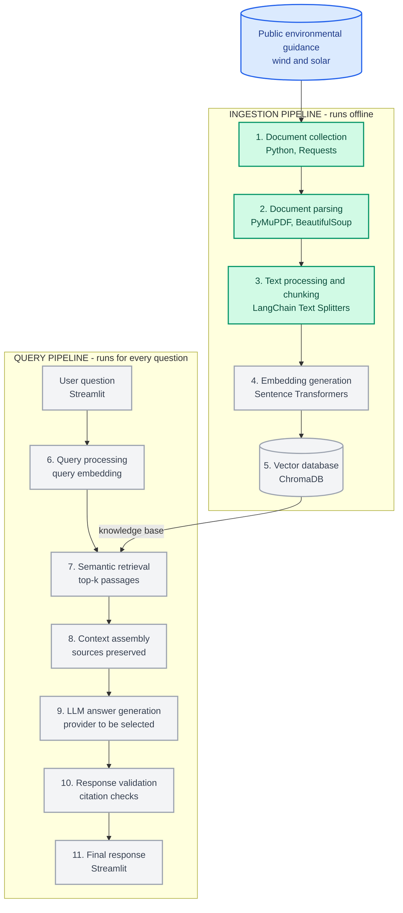

# 🌱 Environmental Risk Assessment Assistant

### A Retrieval-Augmented Generation (RAG) project for wind and solar energy guidance

**Find relevant environmental guidance. Generate source-grounded answers. Keep references close to the evidence.**

 

---

## 📌 Overview

The **Environmental Risk Assessment Assistant** is a RAG-based application being developed to help users explore public environmental guidance for **wind and solar energy projects**. It is designed to retrieve relevant passages from technical documents and use them to generate answers grounded in the available sources.

The planned interface will let users select a predefined question or enter a custom query, review potential environmental concerns and mitigation measures, and follow source references for further reading.

> **Project status:** Steps **1–3 are implemented**: document collection, document parsing, and text processing/chunking. Steps **4–11 are planned** and are listed under *Planned Implementation & Future Scope*. Update this status as the implementation progresses.

## 🧭 Workflow at a glance

### Status legend

- 🟢 **Implemented (green):** Steps 1–3 — collection, parsing, and chunking.
- ⚪ **Planned (grey):** Steps 4–11 — embeddings, vector storage, query retrieval, LLM generation, validation, and UI.

---

## 🧱 Workflow details

### ✅ Implemented

#### 1. Document collection

**Tools:** Python, Requests

- Download selected public environmental guidance documents.
- Record document titles, source URLs, and publication dates where available.

#### 2. Document parsing

**Tools:** PyMuPDF, BeautifulSoup

- Extract text from PDFs and webpages.
- Preserve page numbers, section details, and source references where available.

#### 3. Text processing and chunking

**Tools:** LangChain Text Splitters, Python

- Clean extracted text.
- Split content into overlapping chunks for downstream retrieval.
- Attach metadata such as source, page, section, energy type, and publication date.

### 🚧 Planned implementation & future scope

#### 4. Embedding generation

**Tool:** Sentence Transformers

- Convert document chunks into numerical vectors using a consistent embedding model.

#### 5. Vector database

**Tool:** ChromaDB

- Store chunks, embeddings, and metadata.
- Persist the searchable knowledge base.

#### 6. Query processing

**Tools:** Streamlit, LangChain, Sentence Transformers

- Let users choose a predefined question or enter a custom one.
- Prepare the query and generate its embedding.
- Identify or select the relevant wind/solar category.

#### 7. Semantic retrieval

**Tools:** ChromaDB, LangChain Retriever

- Search stored embeddings.
- Apply relevant metadata filters.
- Retrieve the top-k matching passages with source references.

#### 8. Context assembly

**Tool:** LangChain

- Combine retrieved passages and the user question.
- Preserve source identifiers and construct an evidence-focused prompt.

#### 9. LLM answer generation

**Tool:** LLM API — provider to be selected

- Summarise environmental concerns and potential impacts.
- Suggest mitigation measures supported by retrieved evidence.
- Acknowledge when the available sources do not provide enough information.

#### 10. Response validation

**Tools:** Python, LangChain

- Check that cited source identifiers refer to retrieved documents.
- Flag missing evidence or invalid source references.

#### 11. Final user response

**Tool:** Streamlit

Present a structured response with:

- Environmental concerns
- Potential impacts
- Potential mitigation measures
- Missing or insufficient information
- Source citations and links

---

## 🛠️ Technology stack

| Area | Tools |
|---|---|
| Document collection | Python, Requests |
| PDF and web parsing | PyMuPDF, BeautifulSoup |
| Text processing | Python, LangChain Text Splitters |
| Embeddings *(planned)* | Sentence Transformers |
| Vector database *(planned)* | ChromaDB |
| Retrieval *(planned)* | LangChain Retriever |
| LLM *(planned)* | Provider to be selected |
| User interface *(planned)* | Streamlit |

## 🎯 Intended outcome

The goal is to make public environmental guidance easier to search and interpret for preliminary wind and solar project risk assessment. The assistant is intended to support exploration and early-stage analysis, **not replace formal environmental impact assessments, qualified expert judgement, or regulatory advice**.

## 🗺️ Next milestones

1. Generate embeddings for the processed chunks.
2. Store embeddings, chunk text, and metadata in ChromaDB.
3. Implement retrieval and inspect the relevance of returned passages.
4. Connect an LLM and generate answers grounded in retrieved sources.
5. Add citation checks and insufficient-evidence handling.
6. Build the Streamlit interface and evaluate the end-to-end workflow.

---

**Built with Python · Focused on evidence-grounded AI for renewable energy**

